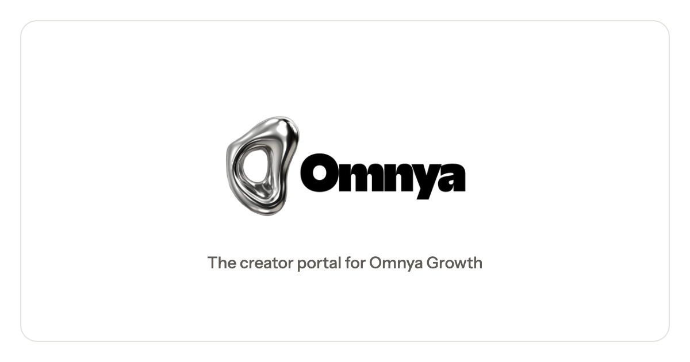

<p align="center"></p>

# Omnya Portal

Creator, brand and staff portal for a UGC agency: campaigns, content submissions, social analytics, creator earnings and payouts.

React SPA (Create React App) + Vercel functions in `api/` + Supabase (Postgres, Auth, Storage).

## Getting started

```bash
npm install
cp .env.example .env          # fill in values; see comments in the file
npm run dev                   # SPA on :3000 and /api/* on :3100
```

Apply the schema with `npm run db:migrate` (`-- --status` to check what's applied). A fresh Supabase project starts from `supabase/SETUP.sql`. See [supabase/migrations/README.md](supabase/migrations/README.md).

## Tests

```bash
node tests/run-all.cjs --offline-only   # fast lane, no servers
CI=true npm test -- --watchAll=false    # Jest
```

## Layout

```
├── api/            Vercel functions, one file per route (_lib/, _utils/ helpers)
├── src/
│   ├── app/        session, workspace loading, nav, routes, shell
│   ├── pages/      screens by area
│   ├── components/ shared feature pieces
│   ├── ui/         primitives (Dialog, Select, Avatar, Pagination, charts…)
│   └── styles/     tokens and global CSS
├── supabase/
│   ├── migrations/ schema source of truth
│   ├── rollbacks/  one per migration, never in migrations/
│   └── SETUP.sql   bootstrap for a fresh project
├── tests/          custom Node harness
├── scripts/        migration runner, ops scripts
├── public/         static assets, legal pages, TikTok verification files
└── docs/
    ├── guides/     deploy, security, payments, social, design
    ├── specs/      feature specs
    └── reports/    dated audits and reviews (historical)
```

Contributor and agent conventions: [AGENTS.md](AGENTS.md).
